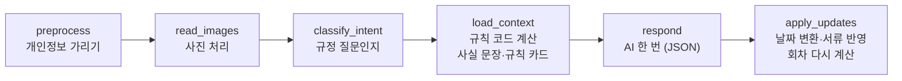
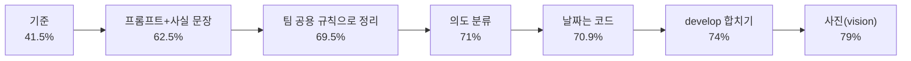

# 실업급여 길잡이 AI 설계 (이슈 #176, 이민수)

> 대화·사진으로 고용24 이력서와 실업인정 신청서를 채우고, 실업급여 절차를 안내하는 AI의 설계 확정본입니다.
> 각 결정은 "대안 → 가설 → 골든셋 측정 → 결정" 순서로 정했고, 숫자는 모두 같은 골든셋(100문항)에서 잰 값입니다.
> 진행 과정과 실험 원자료는 [`learning-log.md`](learning-log.md)에 있습니다.

## 0. 한 장 요약

| 항목 | 내용 |
| --- | --- |
| 핵심 원칙 | **틀리면 안 되는 계산·판정은 규칙 코드, AI는 말 이해·값 뽑기·쉬운 설명** |
| 흐름 | 정해진 6단계 그래프(LangGraph). AI 호출은 한 턴에 1번 |
| 모델 | 답하는 AI `gpt-5.4-mini` (설정 `AGENT_MODEL`만 바꾸면 교체) |
| 결과 | 골든셋 통과율 **41.5% → 79%**, 회차·건수 계산 오류 0, 개인정보 누출 0건 |
| 비용·속도 | 한 턴 약 3,600토큰(그중 약 87% 캐시), **약 $0.0013**, 평균 1.6초 |
| 실험 | 6개 (프롬프트, RAG, 의도 분류, 날짜, 사진, 모델). 버린 대안과 이유까지 기록 |



## 1. AI가 맡는 일

골든셋 4개 영역이 곧 할 일 목록입니다.

| 할 일 | 입력 | 출력 | 골든셋 |
| --- | --- | --- | --- |
| 절차 안내 | 사용자 말 + 내 상황(회차·활동) | 지금 할 일 하나, 숫자·날짜를 넣은 쉬운 답 | 40문항 |
| 서류 채우기 | 말 또는 사진 | 이력서·신청서 칸 값, 재취업활동 기록 | 25문항 |
| 근거 답변 | 규정 질문 | 출처를 밝힌 답, 모르면 고용센터(1350) 안내 | 20문항 |
| 개인정보 보호 | 주민번호·연락처가 섞인 말·사진 | 답·저장값·외부 AI 입력 어디에도 남기지 않음 | 15문항 |

하지 않는 일: 수급 자격·급여액 최종 판정(고용센터), 고용24에 대신 제출(사용자가 직접), 채용 공고 추천(MVP 범위 밖).

## 2. 흐름

| 단계 | 하는 일 | AI 호출 | 코드 |
| --- | --- | --- | --- |
| preprocess | 사용자 말의 주민번호·전화·계좌·카드·이메일·이름을 가림 | 없음 | `agent/nodes/preprocess.py` → 팀 `agent/input/pii.py` |
| read_images | 사진을 다음 단계로 넘길지 정함 (off·vision·transcribe) | transcribe일 때만 | `agent/nodes/read_images.py`, `agent/input/images.py` |
| classify_intent | 활동 규정(인정·증빙·한도) 질문인지 키워드로 판단 | 없음 (llm 모드는 1번) | `agent/nodes/classify_intent.py` |
| load_context | 수급 단계·회차·필요/인정/부족 건수·대상기간 계산 → 출처가 달린 **사실 문장**, 규정 질문이면 **규칙 카드** | 없음 | `agent/nodes/load_context.py`, `rules/situation.py`·`facts.py`·`rule_cards.py` |
| respond | 정해진 JSON 칸으로 답 + 서류 값 | **1번** | `agent/nodes/respond.py`, `prompts/turn/respond.md` |
| apply_updates | 말 그대로 받은 날짜를 코드가 변환, 이력서·활동 반영, 회차 다시 계산 | 없음 | `agent/nodes/apply_updates.py`, `rules/dates.py` |

- 그래프: `agent/turn_graph.py`의 `build_turn_graph()`. 팀 공용 그래프(`agent/graph.py`, SSE 이벤트)는 건드리지 않았습니다. 지금은 골든셋과 `services/agent_turn.py`가 이 흐름을 부르고, 대화 화면 연결은 다음 작업입니다(10절).
- AI 호출이 한 턴에 1번이라 비용·시간이 예측됩니다. 도구 호출을 반복하는 구조(ReAct)를 쓰지 않은 이유는 3-2절에 있습니다.

## 3. 결정 7개: 대안, 근거, 결과

모든 실험은 같은 조건(답하는 AI gpt-5.4-mini, 채점 AI gpt-4.1, 골든셋 100문항)에서 **하나만 바꿔** 쟀습니다.
같은 버전도 실행마다 3~8점 흔들리므로, 차이가 그보다 작으면 "좋아졌다"고 하지 않고 영역별·문항별 변화와 비용으로 판단했습니다.

### 3-1. 판단은 누가 하나

| 대안 | 장점 | 단점 |
| --- | --- | --- |
| A. AI가 다 판단 | 만들기 쉬움, 예상 못한 질문에도 답함 | 날짜·회차 계산 실수, 같은 질문에 다른 답, 테스트 어려움 |
| **B. 규칙 코드가 계산, AI는 이해·추출·설명** | 계산이 항상 정확하고 같음, 단위 테스트로 보장, 화면 버튼과 대화가 같은 결과 | 규칙을 코드로 미리 만들어야 함 |
| C. AI가 판단 + 규칙 코드가 검사 | 유연함 | 검사 로직이 결국 B만큼 필요하고 비용은 더 듦 |

**결정: B, 그리고 가설보다 한 걸음 더 나아가 "문장"과 "날짜"까지 코드가 만든다.**

- 최소 버전에서 규칙 코드가 계산한 회차·필요 건수·인정 건수는 기대값과 **하나도 틀리지 않았습니다.** 실패는 모두 답 문구 쪽이었습니다.
- 계산 결과를 숫자로만 주지 않고 **출처가 달린 사실 문장**("이번 회차에 1건이 더 필요해요(12월 22일까지)")으로 만들어 주자 41.5% → 62.5%, **실행 간 흔들림 8점 → 1점**이 됐습니다(실험 1). 행정 안내는 매번 같은 답이 중요해서 안정성을 근거로 채택했습니다.
- AI가 "작년 3월"을 날짜로 바꾸다 흔들리는 것을 발견해(F-001·F-017), AI는 말 그대로 옮기고 코드가 바꾸게 했습니다. 날짜 문항이 17 → 20 / 28로 안정됐습니다(실험 4).

### 3-2. 흐름은 어떻게 짜나

| 대안 | 장점 | 단점 |
| --- | --- | --- |
| **A. 정해진 단계 그래프 (LangGraph)** | 예측 가능, 단계별로 테스트·디버깅 쉬움 | 처음 설계가 필요 |
| B. ReAct (AI가 도구를 골라 반복) | 유연함, 코드 적음 | 엉뚱한 도구·반복 → 비용·시간 예측 어려움 |
| C. 단순 함수 연결 | 가장 단순 | 분기·재시도가 늘면 복잡, 팀 규칙(흐름은 LangGraph)과 다름 |

**결정: A, 6단계.** 계산은 load_context에서 미리 끝내므로 AI가 도구를 부를 필요가 없고, 그래서 한 턴에 AI 호출 1번으로 끝납니다.

설계 초안의 열린 질문 "의도 분류 단계를 둘까?"는 실험으로 답했습니다(실험 3).

| 버전 | 평균 | 절차(38) | AI 호출/100문항 | 문항당 토큰 | 평균 시간 |
| --- | --- | --- | --- | --- | --- |
| 규칙 카드 없음 | 69.5% | 23.5 | 112 | 2,757 | 1.4초 |
| 항상 붙임 | 68.5% | 25.5 | 112 | 3,983 | 1.4초 |
| **키워드로 규정 질문일 때만** | **71%** | **28** | 112 | 3,152 | 1.4~1.7초 |
| AI 분류로 규정 질문일 때만 | 69.6% | 27 | **224** | 3,573 | 2.3초 |

→ 의도 분류 단계를 **둡니다.** 다만 AI 분류는 호출이 2배인데 더 낫지 않아 **키워드**로 합니다(`RULE_CARDS_MODE=keyword`).

### 3-3. 답은 어떤 형식으로 받나

| 대안 | 장점 | 단점 |
| --- | --- | --- |
| A. 자유 문장 후 파싱 | 답이 자연스러움 | 필요한 값을 못 찾거나 잘못 찾음 |
| **B. 구조화 출력 (JSON 칸)** | 값이 항상 정해진 모양, 목록 밖 값 차단 | 칸을 미리 정해야 함 |
| C. 도구 호출로만 전달 | 동작과 답이 일치 | 답 문장은 따로 필요 |

**결정: B.** `reply`, `next_action`(정해진 8개 중 하나), `cites`, 서류 값(`activities`·`careers`·`certifications`·`education`·`desired_*`)을 받습니다(`agent/schemas.py`의 `AgentOutput`). 모양이 틀리면 서류를 건드리지 않습니다. 칸 이름은 골든셋 채점기가 보는 값과 맞춰, 다음 할 일·서류 값을 정답과 바로 대조할 수 있습니다.

### 3-4. 근거는 어떻게 찾나 (RAG)

| 대안 | 장점 | 단점 |
| --- | --- | --- |
| 키워드 검색 (BM25) | 행정 용어가 같으면 잘 찾음, 싸고 빠름 | 사용자가 다른 말을 쓰면 못 찾음 |
| 벡터 검색 (임베딩) | 뜻이 비슷하면 찾음 | 정확한 용어를 놓칠 때 있음, 임베딩 비용 |
| 혼합 (RRF) — *처음 가설* | 두 장점을 합침 | 조금 더 복잡 |
| 정리된 규칙 표 → 규칙 카드 | 출처·검수 정보가 붙은 정확한 규정 | 표에 있는 규정만 다룸 |

| 버전 (실험 2) | 평균 | 기준 대비 | 문항당 토큰 | 평균 시간 |
| --- | --- | --- | --- | --- |
| 검색 없음 (기준) | **69.5%** | — | 2,757 | 1.4초 |
| 키워드 | 61% | -8.5 | 4,158 | 1.5초 |
| 벡터 | 63.5% | -6 | 4,002 | 2.0초 |
| 혼합 | 62% | -7.5 | 4,138 | 2.1초 |

**결정: 처음 가설(혼합 검색)을 기각. v1은 검색을 쓰지 않고(`RETRIEVAL_MODE=none`), 규정은 규칙 카드로 준다.**

- 지식 자료(1350 FAQ 94개 + 고용24 정책 822개)에 정작 필요한 **실업인정 세부 규정**("증빙은 뭘 내나", "학원도 인정되나")이 거의 없었습니다. 검색하면 비슷해 보이는 엉뚱한 글이 들어왔습니다.
- 모든 질문에 참고 글 4개가 붙자, 규정과 무관한 서류 질문(경력 날짜 뽑기)까지 흐트러졌습니다.
- 검색 코드는 설정으로 남겨 두었습니다(`agent/retrieval.py`). 실업급여 규정 위주로 자료를 다시 모으면 다시 시험할 가치가 있습니다.

### 3-5. 어떤 모델을 쓰나

후보 4개를 비교했습니다(실험 6). 먼저 채점 AI 없이 정답 대조로 거르고, 1등과 비슷한 후보만 채점 AI를 켜서 다시 쟀습니다.

| 모델 | 정답 대조 | 골든셋 (채점 포함) | 평균 시간 | 실행 1회(100문항) |
| --- | --- | --- | --- | --- |
| **gpt-5.4-mini** | 78% | 79% | **1.6초** | **$0.13** |
| gpt-5.4 | 78% | 85% | 3.0초 | $0.61 |
| gpt-4.1-mini | 65% | — | 1.9초 | $0.08 |
| gpt-5.4-nano | 47% | — | 2.7초 | $0.06 |

**결정: gpt-5.4-mini.**

- nano는 서류 칸을 많이 놓쳤고(7/21), 4.1-mini는 증빙 안내가 많이 빠졌습니다. 둘 다 잡음보다 훨씬 낮아 탈락했습니다.
- gpt-5.4는 +6점이지만 잡음 범위 안이고, **약 5배 비싸고 2배 느립니다.** 50~60대 사용자가 기다리는 시간도 중요합니다.
- 두 모델이 **모두 틀린 13문항**은 모델이 아니라 프롬프트·규칙 표가 풀 문제였습니다(9절). 큰 모델로 바꾸는 것보다 그쪽이 쌉니다.
- 처음 가설("역할별로 다른 모델")은 필요 없어졌습니다. 추출을 따로 부르지 않고 한 번의 호출에서 답과 서류 값을 같이 받기 때문입니다. 채점 AI만 다른 모델(gpt-4.1)로 둡니다(자기 답을 자기가 채점하면 후해짐).
- Upstage Solar는 키가 없어 비교하지 못했습니다. gateway가 공급자를 설정으로 바꾸게 되어 있어 키가 생기면 같은 방식으로 잴 수 있습니다.

### 3-6. 사진 서류는 어떻게 읽나

| 대안 | 장점 | 단점 |
| --- | --- | --- |
| A. 답하는 AI에 사진 그대로 (vision) | 단순, 표·배치까지 이해, 호출 1번 | 사진 속 개인정보가 외부로 전송됨 |
| B. 글자만 받아쓰기 → 가린 뒤 AI — *처음 가설* | AI에 보내는 글에서 개인정보를 가릴 수 있음 | 받아쓰는 단계에서도 사진이 외부로 나감, 호출 2번 |
| C. 로컬 OCR → 가린 뒤 AI | 사진이 밖으로 안 나감 | OCR 도구 설치·품질 확인 필요 |

| 버전 (실험 5) | 사진 문항(9) 평균 | 호출/문항 | 문항당 토큰 | 평균 시간 |
| --- | --- | --- | --- | --- |
| 사진 무시 | 0 | — | — | — |
| **A. vision** | **6** | 1 | 3,658 | 1.6초 |
| B. 받아쓰기 → 가리기 | 4 | 2 | 4,611 | 2.6초 |

**결정: 이번 조건에서는 처음 가설을 기각하고 vision. 다만 기본값은 꺼 둔다(`IMAGE_MODE=off`), 쓰는 환경에서 명시적으로 켠다.**

- 받아쓰기는 글자만 옮겨서 **배치 정보를 잃었습니다**("날짜가 없는 화면", "면접확인서" 구분 실패).
- 주민번호가 보이는 경력증명서·연락처가 보이는 캡처에서도 답·저장값으로 새지는 않았습니다. 그러나 A·B 모두 **사진 자체는 OpenAI로 나갑니다.** 그래서 보안 검토 의견대로 기본은 끕니다.
- Upstage OCR 키와 로컬 OCR이 없어 C는 재지 못했습니다. 사진 속 개인정보까지 막으려면 C가 다음 후보입니다.

### 3-7. 보안은 어떻게 하나

| 위험 | 선택 | 이유 |
| --- | --- | --- |
| 개인정보가 외부 AI로 | 모델에 보내기 **전에** 정규식으로 가림 (팀 `pii.py`) | 주민번호·전화·카드는 모양이 정해져 있어 빠르고 확실. 주민번호·카드·계좌가 남으면 외부 전송 차단 |
| 프롬프트 공격 | 사용자 말을 `<user_message>`로 감싸 분리 + **구조로 막기** | AI가 속아도 회차·건수는 규칙 코드 값이라 바꿀 수 없음 |
| 사실과 다른 기록 요청 | 프롬프트 원칙으로 거절, "사실대로" 안내 | 부정수급 위험 |
| 기록 유출 | 로그·테스트에 발화 원문 없음 | 팀 규칙 |

- 내 가리기 보강을 팀 `pii.py`에 합쳤습니다(팀 결정). 보안 검토가 찾은 빈틈은 모두 고쳤습니다. 예: 한글에 붙은 번호, 점·공백 구분, 날짜로 시작하는 계좌, 이메일 안의 숫자, 따로 말한 주민번호 뒷자리, 문장 끝 이름.
- **모든 실험에서 개인정보 누출 0건**(답·저장값·외부 AI 입력 모두 검사).
- 설계 초안의 마지막 검사(verify) 단계는 아직 만들지 않았습니다. 지금은 숫자를 AI가 계산하지 않는 구조로 위험을 줄였습니다(10절).

## 4. 프롬프트 엔지니어링

프롬프트는 `backend/app/agent/prompts/turn/respond.md`에 있습니다. 고친 원칙과 효과(실험 1):

| 버전 | 바꾼 것 | 평균 | 흔들림 | 절차(38) |
| --- | --- | --- | --- | --- |
| 기준 | 최소 지시 | 41.5% | 7점 | 5.5 |
| A | 숫자는 "N건"·"M월 D일"로 직접, 근거 줄, 결론부터, 거절 원칙 | 59% | 8점 | 15.5 |
| **B** | A + 규칙 코드가 만든 사실 문장을 그대로 옮기게 | **62.5%** | **1점** | **21.5** |

배운 점:

1. **문항에 맞춘 문구를 넣지 않는다.** "12월 22일을 말해라"가 아니라 "상황의 숫자는 답에 직접 써라" 같은 일반 원칙만 넣었습니다. 그래야 점수가 실력을 보여 줍니다.
2. **계산은 프롬프트로 시키지 말고 입력으로 준다.** "계산하지 마라"보다 "계산된 문장을 옮겨라"가 훨씬 안정적이었습니다.
3. **지시 하나가 다른 행동을 바꾼다.** "날짜를 말 그대로 옮겨라"를 넣자 "방금 지원했어요"의 활동 자체를 빼 버렸습니다. "애매해도 활동은 넣고 '오늘'로 적어라"를 더해 해결했습니다.
4. **고정 지시는 앞, 바뀌는 상황은 뒤.** OpenAI 자동 캐시가 앞부분을 재사용해 입력의 약 87%가 캐시 요금으로 처리됩니다.

## 5. 평가 방법

| 항목 | 방법 |
| --- | --- |
| 시험지 | 팀 골든셋 100문항 (`backend/evals/golden/golden_set.csv`), 절차 40·서류 25·근거 20·개인정보 15, 경계값·여러 턴·사진·범위 밖·공격 문항 포함 |
| 정답 대조 | 다음 할 일, 서류 값, 꼭 포함/포함 금지 단어, 근거 줄, 개인정보(답·저장·AI 입력) |
| AI 채점 | 정답이 없는 문장 품질만 DeepEval G-Eval(gpt-4.1, 기준 0.7) |
| 통과 기준 | 한 문항의 검사가 **하나라도** 틀리면 실패 |
| 실험 규칙 | 한 번에 하나만 바꿈, 결정할 때 2회 실행(흔들림 3~8점), 두 번 다 실패한 문항으로 원인 분석 |

비용을 아끼는 검증 순서(공용 키라서):

1. 단위 테스트(규칙·날짜·가리기는 AI 없이 보장)
2. 바뀐 영역·문항만, 채점 AI 끄고(`--golden-area`, `-k`, `--golden-judge=off`)
3. 결정할 때만 전체 1회, 잡음 범위 안일 때만 2회차
4. 기준은 저장된 보고서 재사용, 채점 단계는 캐시(`backend/.cache`)

모델 비교에서 이 순서로 약 $3.0 → $1.6으로 줄였습니다.

## 6. 결과



| 영역 | 최종 (1회) |
| --- | --- |
| 절차 | 29 / 40 |
| 서류 | 20 / 25 |
| 근거 | 16 / 20 |
| 개인정보 | 12 / 15 |
| **전체** | **79% (77 / 98)**, 아직 없는 기능을 위한 참고 문항 2개 제외 |

- 회차·필요 건수·인정 건수 계산 오류 0, 개인정보 누출 0건.
- 79%는 "모든 검사 항목을 완벽히 채운 문항 비율"입니다. 실패 문항 상당수는 답은 맞고 꼭 넣어야 할 단어 하나가 빠진 경우입니다.

## 7. 성능과 비용

| 항목 | 값 |
| --- | --- |
| AI 호출 | 한 턴 1번 (사진 받아쓰기·AI 의도 분류를 켜면 2번) |
| 토큰 | 한 턴 약 3,574 (입력 약 3,400, 그중 약 87% 캐시) |
| 응답 시간 | 평균 1.6초, p95 2.8초 |
| 비용 | 한 턴 약 $0.0013 (gpt-5.4-mini, Standard 요금) |
| 예시 | 사용자 1,000명 × 30턴 ≈ $40 (gpt-5.4였다면 약 $195) |

비용을 줄인 설계: 계산을 코드로 해 AI 호출을 1번으로, 의도 분류는 키워드(호출 0), 검색 없음(토큰 +45~51% 절약), 고정 프롬프트를 앞에 두어 캐시 적중.

## 8. 기존 설계에서 바꾼 점

| 기존 (`graph.py` 메모·설계 초안) | 바꾼 것 | 근거 |
| --- | --- | --- |
| preprocess → load_context → agent → guard/tools → verify | classify_intent 단계 추가, agent↔tools 반복 없이 respond 1번 | 실험 3, 계산을 load_context에서 끝내 도구가 필요 없음 |
| 근거 검색(RAG)을 붙일 계획 | v1은 검색 안 함, 규칙 카드로 | 실험 2: 모든 검색 방식이 6~8.5점 낮춤 |
| 날짜는 AI가 변환 | 규칙 코드가 변환 | 실험 4: 날짜 문항 17 → 20 / 28 |
| 사진은 OCR 먼저 | vision (기본 off) | 실험 5: 6/9 vs 4/9, 호출 1번 |
| 역할별 모델 | 답하는 AI 하나 + 채점 AI | 실험 6, 호출 1번 구조 |
| 반복수급자 규칙 없음 | 규칙 표에 "3차부터 구직활동만, 2주마다 1건" | 팀 결정, 1350 답변 |

함께 고친 버그: 일반 8차부터("7일마다 1건") 필요 건수를 0으로 읽어 "다 채웠어요"라고 잘못 말할 수 있던 문제를 기간을 7·14일씩 나눠 세도록 고쳤습니다.

## 9. 고용24 도메인에 맞춘 점

- **날짜·회차·건수는 틀리면 수급이 끊길 수 있는 값**이라 AI가 아니라 팀 규칙 표(`data/rules/activities.json`, 출처·검수 정보 포함)와 규칙 코드가 정합니다.
- 답에는 고용노동부 1350·고용24 출처를 붙이고, 급여액·자격 최종 판단은 "고용센터(1350)에 확인"으로 넘깁니다.
- 50~60대 사용자에 맞춰 결론부터, 해요체 3~4문장, 숫자는 "N건"·"M월 D일"로 씁니다.
- 신청서는 대신 내지 않고, 사실과 다른 기록 요청은 부정수급 위험을 알리고 거절합니다.

남은 실패 중 두 모델이 모두 틀린 13문항은 도메인 지식 쪽입니다. '구직활동 불러오기'·'캡처' 같은 증빙 안내, 목록 형식, '2개월'(취업 신고 기한)·'대기기간' 같은 규정 숫자입니다. 규칙 표와 프롬프트 원칙을 보강할 다음 후보입니다.

## 10. 한계와 다음 할 일

| 항목 | 상태 |
| --- | --- |
| 대화 화면 연결 | 이 흐름은 골든셋·`services/agent_turn.py`에서만 돌아갑니다. 팀 그래프(SSE 이벤트)에 붙이는 일은 담당을 정해야 합니다 |
| verify 단계 | 아직 없음. 답 속 숫자가 사실 문장과 같은지 코드로 검사하는 단계가 후보 |
| 사진 속 개인정보 | vision을 켜면 사진이 외부로 나감 → 로컬 OCR 후보 |
| RAG | 실업급여 규정 위주로 자료를 다시 모으면 재시험 |
| 측정 횟수 | 최종 79%·모델 비교 2단계는 1회 측정 (비용 절약). 잡음 3~8점 감안 |

## 11. 설정과 실행

| 설정 (`backend/.env`) | 기본값 | 선택지 |
| --- | --- | --- |
| `AGENT_MODEL` / `EXTRACT_MODEL` | (비움, 필수) | 권장 `gpt-5.4-mini` |
| `JUDGE_MODEL` | agent와 같음 | 평가는 `gpt-4.1` 고정 |
| `RULE_CARDS_MODE` | `keyword` | off · always · keyword · llm |
| `DATE_PARSING` | `code` | ai · code |
| `RETRIEVAL_MODE` | `none` | none · keyword · vector · hybrid |
| `IMAGE_MODE` | `off` | off · vision · transcribe |

```bash
cd backend
uv run pytest tests/unit
AGENT_MODEL=gpt-5.4-mini EXTRACT_MODEL=gpt-5.4-mini JUDGE_MODEL=gpt-4.1 IMAGE_MODE=vision uv run pytest evals/test_golden.py -m eval -q
```

보고서는 `backend/evals/reports/golden-*.md`에 생깁니다(커밋하지 않음). 영역만·채점 끄기 옵션은 `backend/evals/README.md`에 있습니다.
